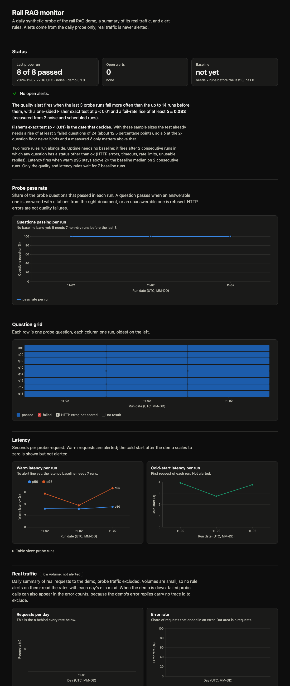
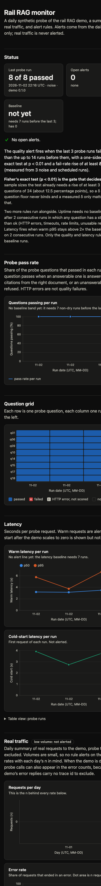
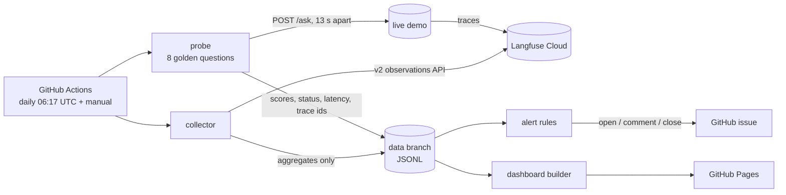

# rail-rag-monitor

[](https://github.com/cardohso/rail-rag-monitor/actions/workflows/ci.yml)
[](https://cardohso.github.io/rail-rag-monitor/)
[](LICENSE)

**Is my RAG assistant getting worse?** This repo answers that every day, for free, with no server.

It watches [rail-regulation-rag](https://github.com/cardohso/rail-regulation-rag) (a RAG assistant over EU railway law, live at the [demo](https://rail-rag.calmcliff-0073b8b6.switzerlandnorth.azurecontainerapps.io)).

## 30-second summary

1. **A daily synthetic probe** asks the live demo 8 fixed golden questions and scores the answers with [goldpass](https://github.com/cardohso/goldpass) (deterministic: right document cited, or correctly refused). Real traffic to the demo is close to zero, so this is the signal that matters. It doubles as an uptime check.
2. **A Langfuse collector** summarises yesterday's real traffic (refusal reasons, errors, latency). It is shown on the dashboard but never alerts, because the volume is too small to alert on.
3. **An alert** opens (or updates) a GitHub issue when the last 3 probe runs fail clearly more often than the 14 runs before them. A one-sided Fisher exact test (p < 0.01) decides.
4. **A static dashboard** on GitHub Pages shows aggregates only: no question, answer or citation text from real traffic is ever stored or published.

Everything runs in one GitHub Actions workflow (cron 06:17 UTC plus manual dispatch). Metrics are JSONL files on a `data` branch. Free tiers only.

**Live dashboard:** https://cardohso.github.io/rail-rag-monitor/





## Architecture



## What is measured, and why

| Signal | Source | Alerts? |
|---|---|---|
| Probe pass rate (answerable: answered with citations from the right document; unanswerable: refused) | probe + goldpass | **yes** (quality rule) |
| Probe HTTP errors, timeouts, rate limits | probe | **yes** (uptime rule) |
| Warm latency p50 / p95, cold-start latency | probe | warm p95 only (latency rule) |
| Refusal rate by reason, error rate, latency, grounding-failure share | Langfuse traces | no (dashboard only) |
| Tokens and cost per request | Langfuse | no: the app does not report them yet, so the dashboard says "not reported by the app" |

Two choices worth knowing:

- **"Answered with at least one citation" is not used as a metric.** The assistant turns any uncited answer into a refusal (`no_citations`), so that rate is 100% by construction. The real grounding signal is the share of refusals that happen *after* retrieval found passages.
- **The probe is the alert signal.** The probe is the only source of volume I control: 8 questions a day, inside the demo's rate limit (5 per minute, 300 per day).

## The alert rule, and why it is set like this

All rules run on the stored probe runs after each probe.

| Rule | Fires when | Needs a baseline? |
|---|---|---|
| **Quality** | the last **3** runs fail more often than the up-to-**14** runs before them: one-sided Fisher exact test **p < 0.01** and a rise of at least δ | yes: **7** baseline runs |
| **Uptime** | **2** consecutive runs in which any question has a status other than `ok` (HTTP errors, timeouts, rate limits, unusable replies) | no |
| **Latency** | warm p95 above **2×** the baseline median on **2** consecutive runs | yes: **7** baseline runs |

An HTTP error is **not** a quality failure: it is not scored, and it counts toward the uptime rule instead.

**The Fisher test is the gate that decides.** δ (the margin) is a secondary safeguard and the code keeps it because the design asked for it, but the numbers show it rarely matters:

- With 24 recent question-runs against a 56 to 112 question baseline, nothing passes p < 0.01 with a rise below 0.125 (3 fails of 24 over a perfectly clean baseline: p = 0.0049). So a δ at its 2-question floor (2/24 = 0.083) can never bind. A *measured* δ only matters above 0.125, where it raises the minimum from 3 to 4 failed questions over a clean baseline.
- Measured false-alarm rate on simulated noise, with per-question pass rates of 0.95 (six questions), 1.0 (one) and 0.85 (the near-domain refusal question): **0.43%** of windows with a 14-run baseline and **0.30%** with the minimum 7-run baseline (10 000 seeded windows each; `test_noise_does_not_fire*`). That is roughly one or two false quality alerts a year if windows were independent, and they are not (they overlap), so treat it as an order of magnitude.
- These are simulated rates built from assumed per-question pass rates. The real per-question noise is measured from the daily runs and recorded in `alerts/noise.json` on the `data` branch (first measurement: 3 back-to-back runs, all 8 questions passed 3 of 3 times, so δ is at its floor, 0.083).

An alert opens one issue per rule (labels `monitor-alert`, `rule:<rule>`), comments when it fires again, and posts a closing comment after 3 evaluations in a row without a firing. Issue bodies contain only numbers, run ids, question ids and Langfuse trace links.

## Planted-regression demo

The repo proves the alert fires on a real regression and stays quiet on noise, in tests and on GitHub.

- `tests/test_alerts.py::test_planted_regression_fires`: 14 clean runs, then 3 runs where 4 answerable questions fail: the quality alert fires (12 fails of 24 against 0 of 112).
- `tests/test_alerts.py::test_noise_does_not_fire` and `..._with_the_minimum_7_run_baseline`: seeded noise windows fire in at most 1% of 10 000 windows.
- `tests/test_alerts.py::test_dry_run_after_errored_or_slow_real_run_yields_only_quality`: a dry run can only trip the quality rule, never uptime or latency, whatever the last real run looked like.
- **On GitHub:** run the workflow with `plant_regression = true`. It skips the live probe, appends three planted bad runs *in memory* (never stored) and opens an issue titled `[dry-run] [monitor] quality alert` with the `dry-run` label. It needs at least 7 stored runs.

<!-- DRY-RUN-RESULT: add link to the real dry-run issue and screenshot after the dry run has been done on GitHub -->

## Limitations

- **Real traffic is near zero.** The latest real trace seen before this project was weeks old, so the real-traffic panels are mostly empty. They are descriptive only and never alert.
- **Proxies, not faithfulness scoring.** Grounding means "the cited documents are the right ones" (deterministic, via goldpass). It does not judge whether the answer text is faithful to the passages.
- **8 questions catch big regressions, not one-question drift.** The test needs at least 3 failed questions over 3 runs (4 if the baseline contains failures). The golden set is fixed and **public** in `probe/golden.jsonl`, copied from goldpass and attributed in `probe/NOTICE.md`.
- **The rolling baseline can absorb a persistent regression.** The baseline is the 14 runs before the last 3, so a regression that never gets fixed slowly becomes the baseline. The quality alert then stops firing, and after 3 silent evaluations the issue gets a closing comment. That comment says "the problem is gone *or* the baseline has absorbed the change; check the dashboard". Freezing the baseline while an issue is open is the first improvement I would make.
- **Probe errors can show up as "real" errors.** When the demo is down, its error replies carry no trace id, so failed probe calls cannot be excluded from the real-traffic error counts.
- **Free-tier limits.** Langfuse Hobby keeps 30 days of data and limits the observations API to 30 requests a minute, so history older than 30 days exists only in this repo's own store (from the first collection onwards). The demo scales to zero (the first request of a run can be slow) and has a daily question budget that the probe shares (normally 8 of 300; at most 33 in a pathological run).
- **Langfuse region.** `LANGFUSE_HOST` defaults to the EU cloud. Set the repository variable `LANGFUSE_HOST` for another region.
- **Not verified yet** (will be filled in as the daily runs accumulate): whether Langfuse's `latency` is in seconds on real traffic, whether a timed-out workflow step reports `failure` or `cancelled` (the final gate fails the job on anything other than success or skipped, so both are covered), and whether the workflow's own commits keep the 60-day schedule alive.

## Privacy

Only aggregates and ids are stored and published: counts, rates, latencies, statuses from a fixed list, run ids, question ids and probe trace ids (kept in the store, never on the page). Every field written or published is built from an allow-list and checked against a fixed pattern, with tests that feed hostile values through the whole chain. No question, answer or citation text from real traffic is read into any stored row.

## Run it locally

```bash
uv sync
cp .env.example .env        # fill in the Langfuse keys; never commit .env
uv run pytest               # offline: Langfuse, GitHub and the demo are mocked
uv run ruff check
```

```bash
set -a; source .env; set +a
uv run python -m rail_rag_monitor probe --kind manual     # asks the live demo 8 questions (about 2 minutes)
uv run python -m rail_rag_monitor collect                 # yesterday's traffic (UTC)
uv run python -m rail_rag_monitor alert                   # evaluates; opens issues only if GITHUB_REPOSITORY and GITHUB_TOKEN are set
uv run python -m rail_rag_monitor build-site --out site   # writes site/index.html
```

To run it on GitHub: fork, add the secrets `LANGFUSE_PUBLIC_KEY` and `LANGFUSE_SECRET_KEY`, set Pages to **GitHub Actions**, and optionally set the variables `DEMO_URL` and `LANGFUSE_HOST`. The first manual run creates the `data` branch.

## Licence

MIT. See [LICENSE](LICENSE). The golden questions in `probe/golden.jsonl` come from [goldpass](https://github.com/cardohso/goldpass) (also MIT).
