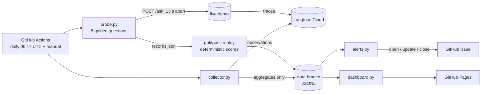

# rail-rag-monitor: design

Date: 2026-11-02 · Status: draft for review · Repo name: `rail-rag-monitor` (confirmed at step 2)

## 1. Goal

Answer "is the rail-regulation-rag assistant getting worse?" from production signals, with a
public dashboard and an alert that fires on a real regression and stays quiet on noise. Free
tiers only. No raw user content is ever published.

## 2. Decisions already made

| # | Decision | Why |
|---|---|---|
| D1 | Alerts come from the synthetic probe only. Real traffic is shown on the dashboard, not alerted. | Latest production trace is 2026-10-18; no window would reach a usable sample size. |
| D2 | Probe: 8 fixed questions, daily at 06:17 UTC, manual dispatch too. One-off 3 back-to-back runs on day one to measure noise. | Agreed 2026-11-02. 8 of the demo's 300 calls/day. |
| D3 | Tokens and cost: "not reported by the app". Collector reads them if they appear later. | Checked 2026-11-02: production generations have empty `usageDetails`, null `totalCost`; model logged as `gemini:gemini-3.5-flash-lite`. |
| D4 | Langfuse access through `GET /api/public/v2/observations` only (plus `GET /api/public/projects` once, for trace links). | v1 metrics and legacy read APIs are being retired on Langfuse Cloud (2026-11-16). One endpoint is also one thing to mock. |
| D5 | Storage: JSONL files on a `data` branch. | Langfuse Hobby keeps 30 days; workflow artifacts expire after 90 days at most; a branch is permanent and diffable. ~10 rows/day does not need DuckDB. |

## 3. Facts the design rests on (read from the code and one read-only API check)

- Production traces: `environment = azure-container-apps` (CI eval uses `ci`, local uses `local`).
- Root observation `name = rag-ask`; `output = {answer, refused, refusal_reason, citations: [passage_id]}`.
- `refusal_reason` ∈ `low_retrieval_score`, `no_relevant_passages`, `insufficient_context`, `no_citations`.
- The graph converts an uncited answer into a `no_citations` refusal, so "answered with ≥1 citation"
  is 100% by construction and is **not** used. The grounding-failure signal is the share of refusals
  with reason `insufficient_context` or `no_citations` (failed after retrieval found passages).
- An `LLMUnavailable` (HTTP 503) marks the root `level = ERROR`. A rate-limit rejection (HTTP 429)
  happens before the pipeline and creates **no trace**; only the probe sees it.
- Probe traces also land in `azure-container-apps`; the collector excludes them by `trace_id`.
- goldpass's HTTP adapter does not keep the response's `trace_id`, so the probe makes its own HTTP
  calls and hands goldpass a replay file to score.
- Hobby limits: 30 days of data, Observations API v2 30 req/min, `limit` ≤ 1000 per page.

## 4. Architecture

Package `rail_rag_monitor` (Python 3.12, uv). Each unit is a pure function plus a thin I/O edge:

| Module | Does | Depends on |
|---|---|---|
| `langfuse_api.py` | Paginated v2 observations fetch; retries on 429 with backoff. | `httpx` |
| `collector.py` | Root observations for one UTC day → one `TrafficDay` row. Drops all text in memory. | `langfuse_api` |
| `probe.py` | Asks the 8 questions, records status, latency, cold/warm, `trace_id`; scores each answer in process with goldpass's own `to_record` and `score_item`. | `httpx`, `goldpass` |
| `stats.py` | `percentile` and the one-sided Fisher exact test. | stdlib |
| `store.py` | Read, append and replace-by-key for the JSONL files. | stdlib |
| `alerts.py` | Rules in §7 → list of `Alert`. No I/O. | stdlib (`math.comb`) |
| `github_issues.py` | One open issue per alert kind: open, comment, close. | `httpx`, `GITHUB_TOKEN` |
| `dashboard.py` | Builds `site/index.html` from the store. | stdlib |
| `cli.py` | `probe`, `collect`, `alert`, `build-site`, `noise-report`. | all above |

Dependencies: `httpx`, `goldpass @ git+https://github.com/cardohso/goldpass@v0.2.0`. Dev: `pytest`,
`ruff`. Tests mock HTTP with `httpx.MockTransport` (no extra library).

## 5. Probe

Golden file `probe/golden.jsonl`: 8 items copied from goldpass `examples/rail/golden.jsonl`
(same licence, attributed).

| Id | Expected | Tag | Source doc |
|---|---|---|---|
| q01 | answer | | tsi-noi |
| q06 | answer | | tsi-prm |
| q09 | answer | | tsi-ccs |
| q10 | answer | | tsi-ope |
| q14 | answer | wrong-document | tsi-srt |
| q15 | answer | wrong-document | iop-directive |
| q17 | refuse | | — |
| q18 | refuse | | — |

Per run: one `GET /health` first (records `demo_version`; not rate-limited), then 13 s between calls, 120 s timeout, up to 3 retries on 503 with 15 s backoff, no retry on
429 (recorded as `rate_limited`). The first call is flagged `cold = true` and is retried once on
timeout, because the demo scales to zero.

**Per-question pass** (the unit the alert counts):
- `answer` item: not refused **and** goldpass `grounding = 1` (cites ≥1 passage, all from the source doc).
- `refuse` item: refused.
- An HTTP error is **not** a quality fail; it counts toward the uptime rule instead.

## 6. Stored data (`data` branch)

`metrics/probe_runs.jsonl`, one row per run (key `run_id`):
`run_id, started_at, commit, kind (scheduled|manual|noise|dry-run), demo_version,
results: {qid: {pass, refused, grounding, status, latency_s, cold, trace_id}},
n_pass, n_scored, n_errors, warm_p50_s, warm_p95_s, cold_latency_s`.

`metrics/traffic_daily.jsonl`, one row per UTC day (key `day`, rewritten if re-collected):
`day, n_requests, n_errors, refusal_rate, refusals_by_reason{…}, grounding_failure_share,
p50_s, p95_s, tokens_per_request (null), cost_per_request (null)`.

`alerts/state.json`: open issue number per alert kind, consecutive-clean-run counter.

No question text, answer text or citation text from real traces is written anywhere. Probe rows
hold scores and trace ids only.

## 7. Alert rules

All rules run on the probe store after each probe run. Rules need a baseline: no quality or
latency alert until the baseline window (the runs before the recent window) holds at least **7**
non-dry-run probe runs.

**R1 Uptime.** 2 consecutive runs where any question ended in an HTTP error (5xx, timeout,
connection) or `rate_limited`. Fires immediately; no statistics.

**R2 Quality.** Recent window = last 3 runs (24 question-runs). Baseline = the up to 14 runs
before it. Let `f_r` and `f_b` be the fail rates. Fire when both hold:
1. One-sided Fisher exact test (recent has more fails) gives `p < 0.01`.
2. `f_r − f_b ≥ δ`, the noise margin.

`δ` is set in step 5 from measured noise: simulate 3-run windows by drawing each question's
pass/fail from its own measured baseline pass rate (fixed seed, 10 000 draws), take the 99th
percentile of `f_r − f_b`, and floor it at 2/24 (two questions). The chosen value and the data it
came from are written to `alerts/noise.json` and quoted in the README.

**R3 Latency.** Warm p95 above 2× the baseline median warm p95 on 2 consecutive runs. Cold-start
latency is shown, not alerted.

**Issue handling.** One open issue per rule, label `monitor-alert` (plus `dry-run` for dry runs).
A new firing comments on the open issue instead of opening another. The issue body has the
numbers, the window, the questions that failed, and Langfuse trace links for those probe
questions (`https://cloud.langfuse.com/project/<projectId>/traces/<traceId>`; the links need the
owner's login). After 3 consecutive clean runs the monitor comments "recovered" and closes it.

**Dry run.** `workflow_dispatch` input `plant_regression: true` skips the live probe, appends 3
planted runs (in memory, never stored) where q01, q06, q09 and q10 refuse with
`no_relevant_passages`, runs the rules on the real history plus those runs, and opens a `dry-run`
issue. Nothing is sent to the demo. It needs the 7-run baseline, so the earliest real dry run is
day 4 (3 noise runs + 1 scheduled on day 1, then 1 a day).

## 8. Dashboard

One static `index.html` on GitHub Pages, rebuilt each run, data embedded as JSON, charts with
Vega-Lite pinned from jsDelivr. Sections:
1. Status: last run time, open alerts with links, `δ` and the rule in one sentence.
2. Probe pass rate per run, with the baseline mean and band.
3. Per-question pass/fail grid (questions × runs).
4. Warm p50/p95 and cold-start latency per run.
5. Real traffic per day: requests, error rate, refusal mix by reason, grounding-failure share,
   latency, each with its `n`. Marked "low volume: not alerted". Tokens and cost: "not reported by the app".

## 9. Workflows

- `ci.yml` (push, PR): `ruff check`, `ruff format --check`, `pytest`. Badge in README.
- `monitor.yml` (cron `17 6 * * *` + dispatch with `plant_regression` and `noise_runs` inputs):
  checkout `main` and the `data` branch → probe → collect yesterday (UTC) → alerts → build site →
  commit to `data` → deploy Pages. Permissions: `contents: write`, `issues: write`,
  `pages: write`, `id-token: write`. Secrets `LANGFUSE_PUBLIC_KEY`, `LANGFUSE_SECRET_KEY`, added by
  the owner. `concurrency: monitor`, no cancel.
- Secret scan (`gitleaks` on the working tree and history) before the first push.

## 10. Tests (offline)

- Collector: fixture observation pages → expected `TrafficDay`; probe trace ids excluded; ERROR
  level counted; missing usage gives null, not 0; pagination follows `meta.cursor`; text never
  reaches the output row.
- Probe: `MockTransport` demo → replay file shape, 429 → `rate_limited` with no retry, 503
  retried, cold flag on first call, pass rule per §5.
- Alerts: **planted regression** (4 answerable questions fail for 3 runs over a clean 14-run
  baseline) fires R2; **noise** (10 000 seeded windows at the measured per-question rates) fires
  R2 in ≤ 1% of windows; fewer than 7 baseline runs never fires; R1 needs 2 consecutive runs;
  R3 ignores cold latency.
- Issues: open when none, comment when open, close after 3 clean runs (GitHub API mocked).
- Dashboard: builds from a fixture store; contains no field outside the aggregate schema.

## 11. Limitations (go in the README)

- Real traffic is near zero, so production metrics are descriptive only.
- Grounding is a proxy (right document cited), not faithfulness scoring.
- 8 questions catch large regressions (several questions breaking), not a single-question drift.
- Probe runs share the demo's daily budget and Gemini's free quota; a quota outage shows as R1.
- Langfuse Hobby keeps 30 days, so traffic history before the first collection is lost.
- GitHub may disable scheduled workflows in public repos after 60 days without activity; whether
  the workflow's own commits count is to be checked in step 7.

## 12. Definition of done

Scheduled workflow green on ≥ 3 consecutive days; dashboard live with real data; planted
regression fires in a test and in one real dry run; no raw user content published; CI green;
gitleaks clean before the first push.
